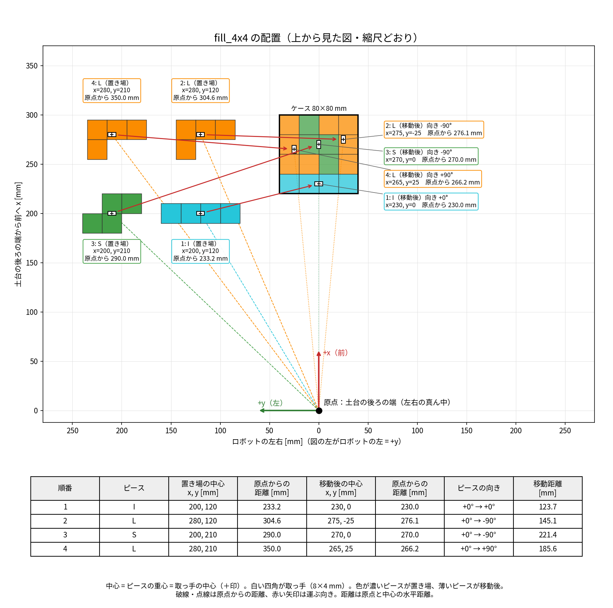

# 4×4 の実機確認（手順書）

カメラなしで、決まった位置の 4 ピース（I・S・L・L）を 4×4 に敷き詰めるプログラムを、実機で確かめます。**このプログラムは実機で動かすのが初めてです。** 必ず 1 動作ずつ確かめてください。

コマンドは `Ctrl + Alt + T` で開く **普通のターミナル** に、1 行ずつ貼り付けます（VSCode の中のターミナルは使わない）。

## 安全の決まり

- **いつでも非常停止スイッチを押せるようにする。** 危ないと思ったら迷わず押す
- 動かす前に、腕の届く範囲に手や物がないことを確かめる
- **ソフトを止めると腕の力が抜けて倒れる。** 止める前に腕を手で支える
- 動かさないとき（PC で作業するときなど）は、線を抜く

## 1. 準備（最初の 1 回だけ）

README の「セットアップ」が終わっている PC で行います。ターミナルで実行します。

```bash
sudo apt install -y xterm
cd ~/ros2_ws/src/seisakuron2026_tukamukai
git fetch origin
git switch feature/fill-4x4
git pull
cd ~/ros2_ws
source /opt/ros/jazzy/setup.bash
rosdep install -r -y -i --from-paths src
colcon build --symlink-install
```

最後に `Summary: ... packages finished` と出て、`failed` がなければ OK です。

`git switch` で「変更が上書きされる」と出て止まったら、自分で変えたファイルがあるということです。消さずに、担当に相談してください。

## 2. ピースとケースを置く



図の下の中央が原点（**ロボットの土台の中心**）です。x がロボットの前、y がロボットの左です。定規で測って、机にテープで印を付けます。

**ケース**：角を x = 220 mm、y = -40 mm に合わせます（前 22〜30 cm、左右 ±4 cm）。枠がなければ、80 mm 角のマスを紙に書きます。

**ピース**：**取っ手の中心** を次の位置に合わせます。

| ピース | x | y |
|---|---|---|
| I | 200 mm | 120 mm |
| L（1 個目） | 280 mm | 120 mm |
| S | 200 mm | 210 mm |
| L（2 個目） | 280 mm | 210 mm |

向きは次の図のとおりです（上から見て、上がロボットの前）。

```
I:  I I I I     S:  . S S     L:  L L L
                    S S .         L . .
```

## 3. ロボットを起動する

1. 腕を手で動かして、指が土台や肩に当たっていない形にする
2. ロボットの電源を入れる。USB を PC につなぎ、抜けないようにテープで留める
3. ターミナルを開き（**ターミナル 1**）、番号を確かめる

```bash
ls /dev/ttyUSB*
```

`/dev/ttyUSB0` と出れば、そのまま進みます。`ttyUSB1` と出たら、以下のコマンドの `ttyUSB0` を `ttyUSB1` に置き換えます。

4. 通信の設定をする（USB をつなぐたびに必要。パスワードを聞かれたら入力する）

```bash
echo 1 | sudo tee /sys/bus/usb-serial/devices/ttyUSB0/latency_timer
```

5. ロボットを起動する

```bash
source ~/ros2_ws/install/setup.bash
ros2 launch crane_x7_examples demo.launch.py port_name:=/dev/ttyUSB0 timeout_seconds:=3.0
```

RViz の画面が開き、腕に力が入れば成功です。**このターミナルは閉じません。** 起動したら、間を空けずに次へ進みます（2 分ほど放っておくと、力が抜けることがあります）。

## 4. 確認する

**新しいターミナル**（**ターミナル 2**）を開き、最初に 1 回だけ実行します。

```bash
source ~/ros2_ws/install/setup.bash
```

以下のコマンドを実行すると、黒いウィンドウ（xterm）が開きます。**xterm をクリックしてから** 操作します。

- `Enter`：次の動作を実行する
- `q` のあと `Enter`：中止する（腕はその場で止まる）

1 つ終わったら、xterm を閉じてから次のコマンドを実行します。

### 確認 1：home に戻る

```bash
ros2 launch tukamukai pick_place.launch.py mode:=home step_by_step:=true speed_scale:=0.3
```

**合格**：腕が折りたたんだ姿勢になる。指が開いて、最後に閉じる。

### 確認 2：指の開き幅

```bash
ros2 launch tukamukai pick_place.launch.py mode:=gripper gripper_open_deg:=5 gripper_grasp_deg:=0 step_by_step:=true speed_scale:=0.3
```

**測る**：指が 5° 開いたときの、指の間の幅。**目安は約 12 mm**（計算値）。

### 確認 3：指が取っ手の広い面を挟むか

L を 1 個だけ、取っ手の中心が **x = 250 mm、y = 0** に来るように、上の図の向きで置きます。ほかのピースはよけます。

```bash
ros2 launch tukamukai pick_place.launch.py mode:=pick_move pick_piece_deg:=0 place_piece_deg:=0 step_by_step:=true speed_scale:=0.3
```

**合格**：指が取っ手の **広い面** を挟む。ピースが傾かずに持ち上がり、左へ 15 cm（y = 150 mm）運ばれて置かれる。

**指が下りる前に、指と取っ手の位置を見ます。** 細い面を挟みそう、または当たりそうなら `q` で中止します。

### 確認 4：手首を回す向き

L を確認 3 と同じ位置・同じ向きに戻します。

```bash
ros2 launch tukamukai pick_place.launch.py mode:=pick_move pick_piece_deg:=0 place_piece_deg:=-90 step_by_step:=true speed_scale:=0.3
```

**合格**：上から見て **時計回りに 90°** 回って、次の向きで置かれる。

```
L L
. L
. L
```

### 確認 5：4 ピースを敷き詰める

手順 2 のとおりに、4 ピースとケースを置きます。

```bash
ros2 launch tukamukai pick_place.launch.py mode:=fill_4x4 step_by_step:=true speed_scale:=0.3
```

置く順番は **I → L → S → L** です。**合格**：4 個とも図の位置に入る。となりのピースや取っ手に当たらない。

## 5. 終わるとき

1. xterm を閉じる
2. **腕を手で支える**
3. ターミナル 1 で `Ctrl + C` を押す
4. ロボットの電源を切り、線を抜く

## 6. 困ったとき

| 症状 | すること |
|---|---|
| `There is no status packet` が出る | 電源と非常停止スイッチを確かめる。ターミナル 1 を `Ctrl + C` で止めて、起動し直す |
| `Communication timeout!` が出て力が抜ける | 腕を支える。USB を確かめ、手順 3 からやり直す（番号が変わることがある） |
| `START_STATE_INVALID` が出て動かない | ターミナル 1 を止めて、関節を手で少し動かしてから起動し直す（[troubleshooting](troubleshooting.md)） |
| `START_STATE_IN_COLLISION` が出て動かない | ターミナル 1 を止めて、指を肩や土台から手で離してから起動し直す |
| 実機に力が入らない（ログに `mock_components`） | [troubleshooting](troubleshooting.md) の「実機を起動したのに、アームに力が入らない」を見る |
| `no reachable hand yaw`、`no IK solution` | そのピースに手が届かない。腕は動いていないので、ログを記録して担当に伝える |
| 指がピースや机に当たりそう | `q` で中止する。コマンドの最後に `pick_z:=0.108` を足して（3 mm 上げて）やり直す |

ほかの症状は、ターミナルのログをスマホなどで撮って、担当に見せてください。

## 7. 確認すること（記録して担当に渡す）

| # | 確認すること | 結果（○・×・値） |
|---|---|---|
| 1 | home に戻れた | |
| 2 | 指を 5° 開いたときの幅（目安 12 mm） | mm |
| 3 | 指が取っ手の広い面を挟んだ | |
| 3 | ピースが傾かずに持ち上がった | |
| 3 | 置いた位置（目標 x = 250, y = 150 mm） | x = 、y = |
| 4 | 時計回りに 90° 回って置かれた | |
| 5 | I が枠に入った | |
| 5 | L（1 個目）が枠に入った | |
| 5 | S が枠に入った | |
| 5 | L（2 個目）が枠に入った | |
| 5 | 指がとなりの取っ手に当たらなかった | |
| 5 | 指を開いたとき、ピースが指から離れた | |
| 5 | 4 個にかかった時間（Enter で進めた時間も含む） | 分 |

**測ってほしい実物の寸法**

| 項目 | 値 | 使い道 |
|---|---|---|
| 枠の高さ | mm | 指や持っているピースが枠に当たらないか |
| 枠の底板の厚さ（なければ 0） | mm | 置く高さに足す |
| 取っ手の高さ（ピースの上面から） | mm | つかむ高さ（資料は 12 mm、以前の話では 7 mm） |

**気づいたこと**（当たった場所、ずれた向き、変な音など）：

```
```

結果は GitHub の PR #71 にコメントで書いてください。
