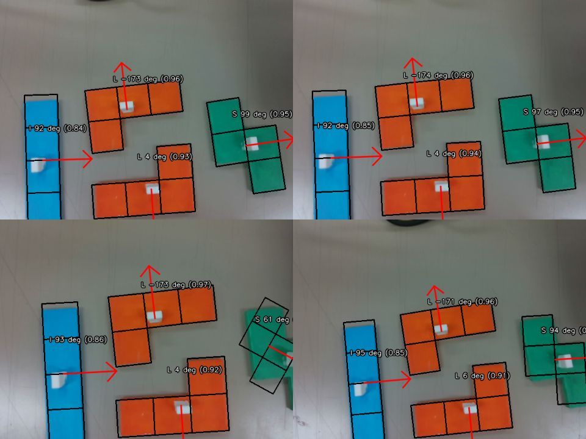

# ピースの角度を求めて、置く向きに手首を回す

カメラの画像からピースの向き（角度）を求め、ロボットが手首を回して、ソルバーが決めた向きでケースに置くまでの流れです。

```
色の切り出し（B：認識）──マスク──▶ estimate_piece_angle ──画像上の角度──▶ ロボット座標の角度
      ──tf piece_<種類>_<番号>──▶ fill_4x4（piece_source:=tf）──▶ 手首を回して置く
```

| 部分 | どこにあるか | 担当 |
|---|---|---|
| 色の切り出し（どの画素がどのピースか） | 認識のコード | B（堀さん） |
| **画像上の角度を求める** | `include/tukamukai/piece_angle.hpp`（ライブラリ `tukamukai_angle`） | この文書 |
| **ロボット座標の角度にする** | 同上（`image_down_yaw`、`image_yaw_to_robot_yaw`） | この文書 |
| tf を出す | 認識のノード | B（堀さん） |
| 置く向きまで手首を回す | `fill_4x4` の `piece_source:=tf`（[real_robot.md](real_robot.md)） | D・C |

## 角度の求め方

ソルバーと同じ形（`tukamukai::shape`）を少しずつ回して、切り出した領域と重ね、一番よく重なる（IoU が最大の）角度を選びます。

- L・J・T は左右非対称なので、**360° 区別できます**（輪郭の傾きだけでは 180° 違いを区別できない）
- 白い取っ手の穴は、内側を塗りつぶしてから比べるので、影響しません
- 重心（`center`）が取っ手の位置です

## 使い方（認識のノードから呼ぶ）

```cpp
#include "tukamukai/piece_angle.hpp"

// mask：そのピースの画素が 255、それ以外が 0 の画像（CV_8U）。1 つのピースだけを入れる
const auto r = tukamukai::estimate_piece_angle(mask, 'L');
if (r) {
  r->yaw;     // 画像上の向き [rad]（画像を見て反時計回りが正）
  r->center;  // 取っ手の位置 [px]
  r->score;   // 形の重なり（0〜1）。0.8 より小さいと std::nullopt になる
}
```

`CMakeLists.txt` では、ノードに `target_link_libraries(<ノード> tukamukai_angle)` を足します。

**画像の端に触れているピースは使わないでください。** 一部しか写っていないと、角度を間違えることがあります（下の録画の結果）。撮り直すか、撮影姿勢を変えます。

## 画像上の角度 → ロボット座標の角度

画像上の向きは、ソルバーの形の (行, 列) を画像の (下, 右) に重ねた向きを 0 とし、**画像を見て反時計回り** を正とします。カメラが真上から見下ろしているとき、これは [interfaces.md](interfaces.md) のピースの yaw と同じ回り方なので、足し算だけで直せます。

```
ロボット座標の yaw = （画像の下向きが base_link で向いている角度） + 画像上の yaw
```

「画像の下向き」は、カメラのフレーム `camera_color_optical_frame` の **y 軸** です。tf2 で base_link から見たカメラの向きを取り、その y 軸の水平な成分の向きを使います。

```cpp
// tf2 で base_link ← camera_color_optical_frame の変換 t を取ったあと
tf2::Quaternion q;
tf2::fromMsg(t.transform.rotation, q);
const tf2::Vector3 y_axis = tf2::quatRotate(q, tf2::Vector3(0, 1, 0));  // 画像の下向き
const double down = tukamukai::image_down_yaw(y_axis.x(), y_axis.y());
const double robot_yaw = tukamukai::image_yaw_to_robot_yaw(r->yaw, down);
```

この `robot_yaw` を、tf `piece_<種類>_<番号>` の向きとして出せば、`fill_4x4` が置く向きまで手首を回します（[real_robot.md](real_robot.md) の「認識の結果からつかむ」）。

## 録画で確かめた結果（2026-10-26 の rosbag）

`~/ダウンロード/d435_recording`（カメラを手で持って撮ったもの、640×480）のフレームで試しました。色の切り出しは確認用の簡単なもの（HSV）を使いました。



黒い線が当てはめた形、赤い矢印がピースの x 軸（基準の向きで画像の下向き）、数字が画像上の角度と重なり（score）です。

| ピース | 12.6 秒 | 15.8 秒 | 22.0 秒 | 43.7 秒 |
|---|---|---|---|---|
| L（上） | -173.5° (0.96) | -174.0° (0.96) | -173.5° (0.97) | -171.0° (0.96) |
| L（下） | 4.0° (0.93) | 3.5° (0.94) | 3.5° (0.92) | 6.0° (0.91) |
| S | 98.5° (0.95) | 97.0° (0.95) | **61.0° (0.65)**：端で切れて誤り | 93.5° (0.83) |
| I（下の端で切れている） | 91.5° (0.84) | 92.0° (0.85) | 93.0° (0.86) | 95.0° (0.85) |

- 全体が写っているピースは、score が 0.91 以上で、フレームが違っても角度は数度の範囲でそろった。カメラを手で持っていて、少し斜めから見ているフレームもある
- 画像の端で切れた S を 61° と間違えた（score 0.65）。そのため、score 0.8 未満は「分からない」とした

## まだ確かめていないこと

- 実機の撮影姿勢（真上から見下ろす）での角度と、実際のピースの角度の差（分度器などで測って比べる）
- ロボット座標の角度にしたあと、`fill_4x4` で置いた向きが合っているか
- 斜めから見たときの誤差（真上からでないと、形が台形にゆがむ）
