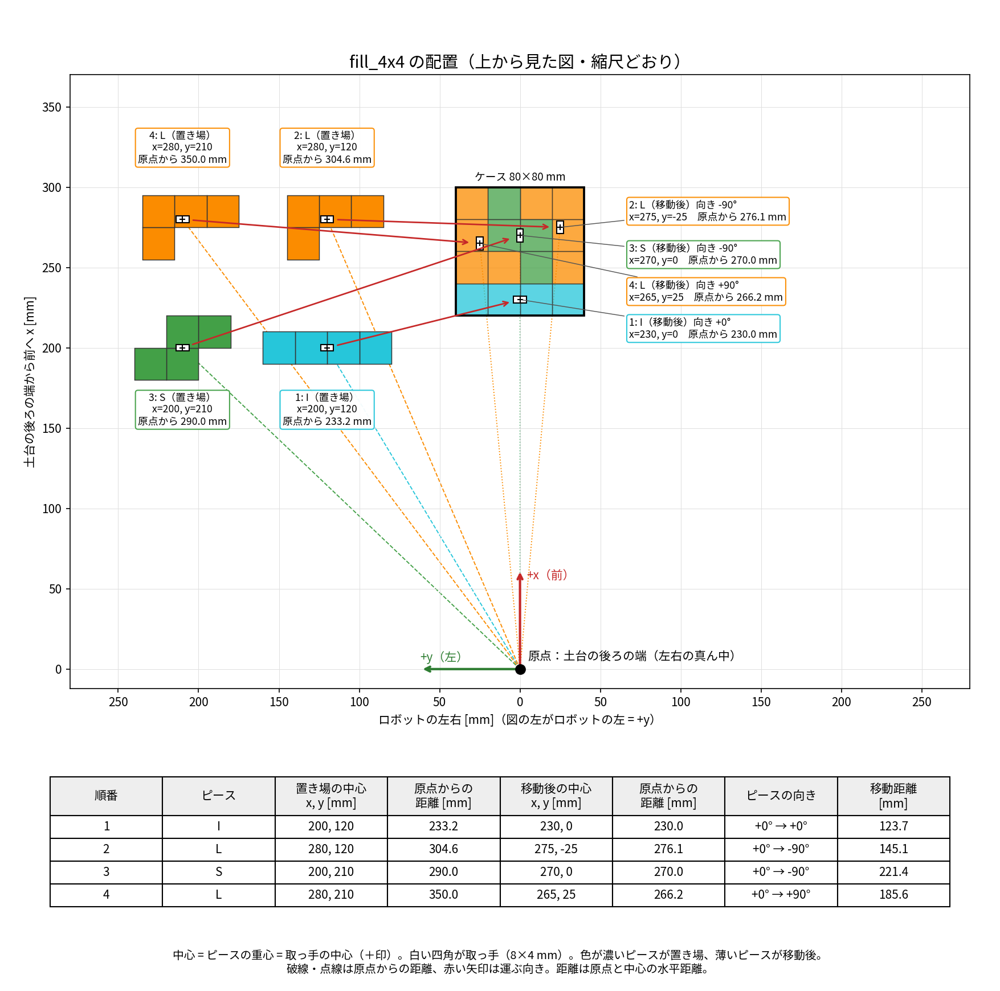

# 実機（CRANE-X7）の動かし方

CRANE-X7 本体を PC につないで動かす手順です。2026-10-19 にこの手順で、カメラなしのサンプル5つ（`gripper_control`・`pose_groupstate`・`joint_values`・`cartesian_path`・`pick_and_place`）が実機で動くことを確かめました。

RViz の操作やサンプルの中身はシミュレーションと同じです（→ [simulation.md](simulation.md)）。シミュレーションとの違いは、**USB の設定が毎回いる**ことと、**サンプルに `use_sim_time:=true` を付けない**ことです。

## 0. 始める前に（最初の1回だけ）

- [README のセットアップ](../README.md#セットアップ) が終わっていること（ビルドまで）
- README の手順3（`sudo usermod -aG dialout $USER`）を実行して、ログインし直していること。次のコマンドで `dialout` が表示されれば OK です

```bash
groups
```

## 1. ロボットをつなぐ

1. まわりに人や物がないことを確かめる
2. CRANE-X7 の電源を入れ、USB ケーブルで PC につなぐ
3. PC がロボットを認識したか確かめる

```bash
ls -l /dev/ttyUSB0
```

`crw-rw---- 1 root dialout ... /dev/ttyUSB0` のように出れば OK です。`そのようなファイルやディレクトリはありません` と出たら、ケーブルと電源を確認してください。

## 2. USB の通信設定（つなぐたびに毎回）

USB の通信の待ち時間（`latency_timer`）を短くします。USB を抜き差ししたり PC を再起動したりすると元の値（16）に戻るので、**つなぐたびに** 実行します。

```bash
echo 1 | sudo tee /sys/bus/usb-serial/devices/ttyUSB0/latency_timer
```

`1` と表示されれば OK です。今の値は次で確認できます。

```bash
cat /sys/bus/usb-serial/devices/ttyUSB0/latency_timer
```

## 3. 起動する

**普通のターミナル（`Ctrl + Alt + T`）** で実行します。RViz が開くので、VSCode の中のターミナルだと落ちます（→ [troubleshooting](troubleshooting.md) の「VSCode のターミナルから起動すると RViz が落ちる」）。

```bash
ros2 launch crane_x7_examples demo.launch.py port_name:=/dev/ttyUSB0
```

- 起動すると、**そのときの姿勢のまま各関節に力が入ります**（手で押しても動かなくなる）
- RViz が開き、実機と同じ姿勢のロボットが表示されます
- ターミナルにはログがたくさん流れますが、`[ERROR]` が出続けていなければ大丈夫です

### 起動できたか確かめる

画面だけでは分かりにくいときは、**別のターミナル** で次を実行します。

```bash
# /crane_x7, /controller_manager, /crane_x7_arm_controller, /move_group などが出れば OK
ros2 node list

# 実機の関節の角度が届いているか（position に数字が並べば OK）
ros2 topic echo --once /joint_states
```

## 4. 動かす

起動したターミナルはそのままにして、**別のターミナル** で操作します。

### RViz で決まった姿勢に動かす（最初はこれがおすすめ）

1. 左下の「MotionPlanning」パネルの下のほうにある **Velocity Scaling** を `0.1` くらいにする（ゆっくり動く）
2. 「Planning」タブの「Goal State」で `home`（腕を折りたたんだ待機姿勢）を選ぶ
3. オレンジ色の目標の姿勢を見て、ぶつかるものがないか確かめる
4. 「Plan & Execute」を押す

### サンプルプログラム

```bash
ros2 launch crane_x7_examples example.launch.py example:=gripper_control
```

`example:=` を変えるとほかのサンプルも動かせます（一覧は [simulation.md のサンプルプログラム](simulation.md#サンプルプログラム)）。実機では `use_sim_time:=true` を **付けません**。おすすめの順番は次のとおりです。

| 順番 | example | 動き |
|---|---|---|
| 1 | `gripper_control` | ハンドを開いたり閉じたりする |
| 2 | `pose_groupstate` | `home` → `vertical`（まっすぐ上）→ `home` |
| 3 | `joint_values` | 関節を1つずつ動かす |
| 4 | `cartesian_path` | 手先で円を描く |
| 5 | `pick_and_place` | つかんで、運んで、置く |

> [!WARNING]
> `pose_groupstate` と `pick_and_place` は **最大の速さ** で動きます。腕の届く範囲に何も置かず、すぐ電源を切れるようにしておいてください。

`pick_and_place` は、ロボットの土台の中心から見て次の位置を使います（X が前、Y が左）。最初は **物を置かずに** 動きだけ確かめると安心です。

| | X | Y | 場所 |
|---|---|---|---|
| つかむ位置 | 0.20 m | 0.00 m | 土台の正面 20 cm |
| 置く位置 | 0.20 m | 0.20 m | 正面 20 cm、そこから左に 20 cm |

## 4×4 を敷き詰める（カメラなし）

決まった位置（置き場）に置いた 4 ピース（I・S・L・L）を、ソルバーの答えどおりに 4×4 のケースへ運びます。**実機ではまだ動かしていません**。最初は必ず 1 動作ずつ確かめてください。

初めて動かす人向けの手順と確認項目は [fill_4x4_check.md](fill_4x4_check.md) にあります。

```bash
ros2 launch crane_x7_examples demo.launch.py port_name:=/dev/ttyUSB0 timeout_seconds:=3.0
# 別のターミナルで
ros2 launch tukamukai pick_place.launch.py mode:=fill_4x4 step_by_step:=true speed_scale:=0.3
```

配置は次の図のとおりです（上から見た図。縮尺どおり）。



**ピースの置き方**：X は土台の後ろの端から、Y は土台の左右の真ん中から測って、**取っ手の中心** を次の位置に合わせます（X が前、Y が左。2026-11-02 に実機で 1 か所測って分かった起点で、ほかの位置ではまだ確かめていません）。

| 順番 | ピース | 置き場 X | 置き場 Y | ケースに置く位置 X, Y | 置く向き |
|---|---|---|---|---|---|
| 1 | I | 0.20 m | 0.12 m | 0.230, 0.000 m | 0° |
| 2 | L | 0.28 m | 0.12 m | 0.275, -0.025 m | -90° |
| 3 | S | 0.20 m | 0.21 m | 0.270, 0.000 m | -90° |
| 4 | L | 0.28 m | 0.21 m | 0.265, 0.025 m | 90° |

置き場では、4 つとも同じ向き（向き 0°）に置きます。上から見て、前が上、左が左の図です。

```
I:  I I I I     S:  . S S     L:  L L L
                    S S .         L . .
```

**ケース**：マス (0, 0) の外側の角を X = 0.22 m、Y = -0.04 m に合わせます（前 22〜30 cm、左右 ±4 cm）。枠がないときは、80 mm 角のマスを印刷した紙で試せます。

| 引数 | 初期値 | 内容 |
|---|---|---|
| `case_x` `case_y` `case_yaw_deg` | 0.22, -0.04, 0 | ケースの角の位置と向き |
| `tray_x` `tray_y` `tray_dx` `tray_dy` | 0.20, 0.12, 0.08, 0.09 | 置き場の先頭の位置と間隔 |
| `tray_piece_deg` | 0 | 置き場のピースの向き |
| `pick_z` | 0.105 | つかむ高さ（手首の付け根）[m] |
| `fill_release_dz` | 0.003 | つかむ高さよりこれだけ上で離す [m] |
| `fill_place_open_deg` | 5 | 離すときの指の角度。20° だととなりの取っ手に当たる計算 |
| `fill_lift_dz` | 0.08 | 持ち上げる高さ [m] |

動き出す前に、全部のピースに手が届くかを確かめます。届かないときや、手首が 1 回も回らないときは、動かずに止まります。

### 認識の結果からつかむ（`piece_source:=tf`）

置き場を決め打ちにせず、認識のノードが見つけたピースの位置と向きからつかみます。認識のノードは、見つけたピースごとに **tf のフレーム** を出します（お手本の `color_detection` が `target_0` を出すのと同じやり方）。

| 決まり | 内容 |
|---|---|
| フレーム名 | `piece_<種類>_<番号>`。例：`piece_I_0`、`piece_S_0`、`piece_L_0`、`piece_L_1`。同じ種類は 0, 1, … と番号を振る |
| 親のフレーム | `base_link`（`camera_color_optical_frame` などから出してもよい。tf2 が `base_link` に直す） |
| 位置 | **取っ手の中心**（ピースの重心の真上）。高さ（z）は使わない |
| 向き | ピースの yaw（上から見て反時計回り、[docs/interfaces.md](interfaces.md)）。基準の向き（ソルバーの形）で 0。L は左右非対称なので 360° 区別する。I・S は 180° 違ってもよい |
| 時刻 | 撮った画像の時刻にする。`tf_max_age_sec`（5 秒）より古い tf は使わない |

どのピースをどこに置くかは、種類で決めます（L は `piece_L_0` から順に使う）。必要な種類がそろわないときは、何も運ばずに止まり、足りないものを表示します。

**認識のノードがなくても試せます**（偽物の tf を、上の置き場と同じ位置に出す）：

```bash
ros2 launch tukamukai fake_pieces.launch.py
# 別のターミナルで
ros2 launch tukamukai pick_place.launch.py mode:=fill_4x4 piece_source:=tf step_by_step:=true speed_scale:=0.3
```

偽物の位置と向きは `L_1_yaw_deg:=90.0` のように変えられます（`I_0` `S_0` `L_0` `L_1` ごとに `_x` `_y` `_yaw_deg`）。

| 引数 | 初期値 | 内容 |
|---|---|---|
| `piece_source` | tray | `tray`＝決め打ちの置き場、`tf`＝認識のノードの tf |
| `tf_wait_sec` | 5.0 | ピースがそろうまで待つ時間 [s] |
| `tf_max_age_sec` | 5.0 | これより古い tf は使わない [s] |

認識のノードは 1 枚の画像のピースを **同じ時刻** で出します。画像ごとに `piece_L_0` と `piece_L_1` の番号が入れ替わることがあるので、`fill_4x4` は同じ時刻の tf だけをまとめて使います（違う画像の tf を混ぜると、2 つが同じピースを指すおそれがある）。

#### 認識のノード `piece_tf_node.py`

色でピースを見つけ、上の決まりで tf を出すノードです。色の範囲と切り出し方は堀さんの `perception/scripts/colorecog` と同じ（オレンジ＝L、緑＝S、青＝I）、角度は [piece_angle.md](piece_angle.md) と同じ方法です。

```bash
# ターミナル1：実機とカメラ（use_d435:=true が必要。カメラの位置の tf が出る）
ros2 launch crane_x7_examples demo.launch.py port_name:=/dev/ttyUSB0 use_d435:=true
# ターミナル2：認識のノード
ros2 run tukamukai piece_tf_node.py
# ターミナル3：見つけたピースと角度を描いた画像を見る
ros2 run rqt_image_view rqt_image_view /piece_tf_node/image
# ターミナル4：アームを撮影姿勢にして止めてから、敷き詰める
ros2 launch tukamukai pick_place.launch.py mode:=fill_4x4 piece_source:=tf step_by_step:=true speed_scale:=0.3
```

- 位置は、取っ手を通るカメラの視線と、ピースの上面の高さ（`plane_z`、初期値 0.005 m）の平面との交点です（深度は使わない）
- **カメラが動いている間（0.3 秒前から 2 mm または 1° 以上動いた画像）は tf を出しません。** 画像の左上に `camera moving` と出ます
- 画像の端に触れているピースや、形がよく重ならない（0.8 未満）ピースは出しません

| 引数（`--ros-args -p 名前:=値`） | 初期値 | 内容 |
|---|---|---|
| `image_topic` | /camera/color/image_raw | カラー画像（カメラ単体で起動したときは /camera/camera/color/image_raw） |
| `camera_info_topic` | /camera/color/camera_info | カメラの情報 |
| `plane_z` | 0.005 | ピースの上面の高さ [m]（base_link から） |
| `min_score` | 0.8 | 形の重なりがこれより小さいピースは出さない |
| `still_window_sec` `still_tolerance_m` `still_tolerance_deg` | 0.3, 0.002, 1.0 | 止まっているとみなす条件 |

**確かめたこと（Mock）**：録画（2026-10-26）を流し、仮のカメラの位置（前 25 cm・高さ 35 cm から真下）と D435 の標準的なカメラの情報を与えて、`fill_4x4`（`piece_source:=tf`）で 4 ピースとも最後まで通った。実機ではまだ試していない。

## 実機とカメラを起動し直す

カメラもつなぐときの手順です。USB を差し直したり、通信が切れたりしたあとも、この順番で行います。

USB の番号（`ttyUSB0`、`ttyUSB1`）は、差し直すと変わることがあります。そこで、番号ではなく **USB 変換器の名前** で指定します。名前は機体ごとに違うので、次で確かめます。

```bash
ls /dev/serial/by-id/
```

下の例の `FT3HLLRD` は、2026-11-02 に使った機体です。

1. 開いている xterm を閉じる
2. ターミナル 2 の `pick_place` が止まっていなければ `Ctrl + C`。**腕を手で支えて**、ターミナル 1 でも `Ctrl + C`
3. 残りがないか確かめる（何も出なければ OK。出たら `kill <番号>` で止める）

```bash
pgrep -a "ros2_control|move_group|rviz2|robot_state"
```

4. 腕が倒れない形にして、ターミナル 1 で起動する

```bash
source ~/ros2_ws/install/setup.bash
ros2 launch crane_x7_examples demo.launch.py port_name:=/dev/serial/by-id/usb-FTDI_USB__-__Serial_Converter_FT3HLLRD-if00-port0 use_d435:=true timeout_seconds:=3.0
```

腕に力が入り、その場で止まれば成功です。

5. ターミナル 2 で、つかんで運ぶ確認をする

```bash
source ~/ros2_ws/install/setup.bash
ros2 launch tukamukai pick_place.launch.py mode:=pick_move step_by_step:=true speed_scale:=0.3
```

xterm をクリックして、Enter で 1 動作ずつ進めます（`q` のあと Enter で中止）。L は、取っ手の中心が X = 250 mm（土台の後ろの端から）、Y = 0 に来るように、「L」の字を時計回りに 90° 回した向きで置きます。

ログの `[pick_move] grip: command ... actual ...` が、つかんだあとの指の角度です。持ち上げてピースが落ちるときは、`pick_grasp_deg:=-4` を足すと強く挟めます（-5 より小さくしない。挟んだまま長く止めない）。

**確かめていないこと**：この手順は 2026-11-02 時点のもので、`/dev/serial/by-id/` での起動と `pick_grasp_deg:=-4` は、実機でまだ試していません。`Failed to connect a robot.` と出たら、`ls /dev/ttyUSB*` で出た番号を `port_name` に指定してください。

## 5. 終了する

1. **アームを手で支える**
2. 起動したターミナルで `Ctrl + C`
3. ロボットの電源を切る

`Ctrl + C` で止めるとモーターの力が弱くなり、アームが自分の重さで垂れ下がります。支えずに止めると、机や土台にぶつかることがあります。

## 動かないとき

[troubleshooting](troubleshooting.md) の「実機」を見てください。特に、**起動はできたのにアームが動かない** ときは、肩の関節が動いてよい範囲から少しはみ出していることがよくあります。
